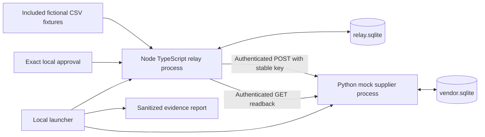

# Architecture

## Browser reconciliation desk

Astro serves a static page with a React workbench. A user pastes or selects two local CSV exports, maps an ID and comparison fields, and inspects evidence from both sources. Neither export is presumed correct. Exact text IDs preserve leading zeroes. Any input, mapping or comparison-option change clears decisions tied to the old comparison. Explicit CSV and JSON downloads preserve findings and review context. Source files and review state remain in the current tab; there is no connected-system write.

## Separate browser simulator

The existing delivery simulator uses `src/lib/core.ts` for partner-order intake and in-memory delivery rules. Exact duplicate rows are suppressed and conflicting rows are quarantined. Local approvals bind to the simulated payload. Its session registry survives visible-ledger truncation but not a tab reset. It does not read reconciliation output or call an order API.

## Separate synthetic HTTP lab

There is no edge between the browser and this lab. The launcher owns child processes and credentials, resolves Python once and starts the actual executable, verifies authenticated readiness, and preserves run state. Ordinary and administration credentials are separate. Only the launcher and supplier receive the administration credential. Commands, fixtures, state paths and fault scenarios are allowlisted. Credentials stay in memory and filtered child environments; they are excluded from arguments and artifacts.

`integration/relay/intake.ts` reuses the existing intake code, then applies the strict version-1 HTTP contract. Enqueue binds an immutable order to its business identity before the first send. Approval lasts ten minutes and is revision-bound. Each POST reserves permission and a request ID in a transaction immediately before I/O. Revoking before that transaction blocks the attempt; revoking afterward may leave an already admitted request in flight.

The supplier uses SQLite uniqueness and canonical payload comparison to accept an identical replay and reject changed content. Relay and supplier stores cannot share one transaction across HTTP. The relay therefore persists uncertain outcomes and reads back the supplier's saved order. A valid POST receipt is only a claim until an exact GET receipt agrees. A malformed or incorrectly correlated 404 cannot authorize another write.

Retry budgets and due times survive process restarts. Read generations prevent a delayed old response from clearing a newer wait. A clock rollback holds writes. The relay never opens the supplier database: evidence uses authenticated HTTP listing and per-order readback. Report inspection requests are separate from the six automatic GET reservations.

These are local process-crash and contract demonstrations. SQLite schema versions are explicit (relay 3, supplier 2); incompatible or missing state is rejected on resume, with no automatic migration. This does not establish power-loss durability, cloud operation, distributed worker fencing, enterprise identity or a universal exactly-once guarantee. See [the contract](integration/CONTRACT.md) and [release checkpoint](integration/RELEASE.md).
