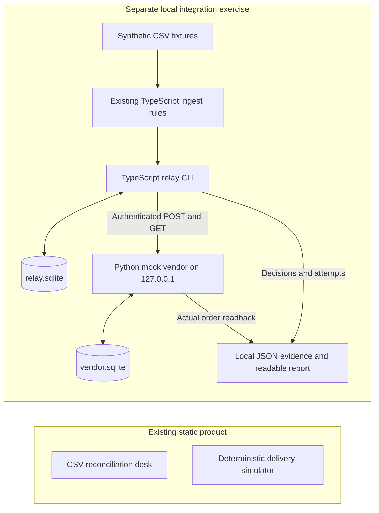

# Field Relay: local mock-vendor integration exercise

Date: 13 October 2026 (Asia/Calcutta)

Status: owner approved the written design on 13 October 2026 with “go ahead, use @Superpowers.” The [implementation plan](../plans/2026-10-13-mock-http-integration.md) is prepared for review; implementation has not started.

Source baseline: `a55564c6f4b0872c8c78c211c8b84fafccf73d64`.

## 1. Purpose and agreed boundaries

Demonstrate how an integration engineer protects an order handoff when a vendor is slow, rejects a request, saves an order but loses its response, or receives an outdated approval. The audience is an enterprise technical evaluator and an operations leader. This is preparation for explaining engineering judgment, not a customer deployment, application, or claim of architect tenure.

Field Relay's main product remains the browser-local CSV reconciliation desk. Its existing delivery lab remains a deterministic browser simulation. Add a separately launched, synthetic-only integration exercise inside this repository. No browser CSV, reconciliation finding, review pack, or browser approval enters the HTTP exercise. No UI redesign or animation is needed.

Success means showing the actual persisted mock-vendor record, its exact payload and unique order count, alongside the relay's decision history. A successful POST or an encouraging trace alone cannot establish delivery. The exercise must survive process restarts, reject conflicting payloads, bound retries, and explain the limit of revoking an already admitted request.

The owner explicitly authorized local mock HTTP and durable state for this exercise. That is a narrow addition to the browser-only product boundaries, not authorization for hosted persistence or a real vendor. Only Field Relay may be edited. Shared `domains.yaml`, host copies, both portfolio repositories, and shared career evidence remain outside this chat's write scope; provide a proposed registry note in the local handoff instead.

## 2. Current evidence and rules to reuse

- `docs/DOMAIN_BRIEF.md` and `docs/CASE_STUDY.md` establish CSV reconciliation as the primary product and the delivery simulator as separate. The root README and architecture introduction still describe the older delivery-first product; their wording needs alignment during implementation documentation work.
- `src/lib/core.ts:127` exports `ingest`, with typed quantities, integer minor-unit amounts, known regions, exact duplicate suppression, and quarantine of all conflicting variants of a business key.
- `src/lib/core.ts:117` requires review for Central-region or at-least-500.00 orders. Reuse that classification; label the value as fixture accounting units, since the source has no currency field.
- `src/lib/core.ts:269` and `src/components/DeliveryLab.tsx:85` show local, payload-bound approval. These are simulation state, not an integration authorization service.
- `src/lib/core.ts:279` binds a key on the first simulated attempt, blocks changed-payload retries, and retains its registry beyond the 500-entry visible ledger. Reuse the invariants, not this in-memory function as an HTTP sender.
- `src/lib/core.ts:223` uses a diagnostic string fingerprint. The new exercise must create its own canonical payload representation and SHA-256 digest, and compare exact canonical content as well as the digest. Do not advertise a diagnostic label as a security proof.

Fresh baseline verification is recorded in `docs/evidence/2026-10-13-integration-design/baseline-qa.log`: the existing application passed its full QA command with 15 unit tests and 20 browser tests. These are existing-product tests, not tests of the proposed integration. The older 7 October release record is historical evidence only.

## 3. Approaches considered

| Approach                                               | Benefit                                                                                                                    | Cost or limitation                                                                                         | Decision                                             |
| ------------------------------------------------------ | -------------------------------------------------------------------------------------------------------------------------- | ---------------------------------------------------------------------------------------------------------- | ---------------------------------------------------- |
| TypeScript relay, Python mock vendor, two SQLite files | Reuses actual intake rules; exercises a language-independent HTTP contract; introduces a small, inspectable Python service | Two runtimes and two implementations of contract validation                                                | Recommended                                          |
| Python relay and Python mock vendor                    | One language for the new subsystem                                                                                         | Requires a bridge or a second implementation of the existing TypeScript intake and approval classification | Reject for this scope: avoid drifting business rules |
| Extend the Astro browser lab to call a backend         | Everything visible in one browser                                                                                          | Alters the memory-only product contract and requires browser authentication, CORS and a broader UI change  | Reject for this scope                                |

Use the existing Node 24 environment and Python 3.14 standard library, without paid calls, new vendor accounts, Docker or cloud provisioning. Node 24.11.0 exposes experimental `node:sqlite`; record that limitation and pin the tested runtime. Python's `http.server` is a local test service, not a production server. A real deployment needs a separate runtime choice and review. These choices are scoped to the exercise, not recommendations for a production estate.

## 4. Architecture and ownership



The relay never opens `vendor.sqlite`. It can establish an outcome only through the vendor's authenticated read API. The vendor never opens `relay.sqlite`, trusts a relay success flag, or accepts an order ID supplied as a fabricated receipt. The test harness may separately inspect both databases to diagnose a failed assertion, but that inspection cannot substitute for the exercise's HTTP readback.

Proposed ownership within this repository:

- `integration/relay/`: CLI, fixture adapter, canonical contract, SQLite state, authorization checks, HTTP transport and evidence exporter.
- `integration/vendor/`: Python HTTP handler, independently validated contract, SQLite transactions, synthetic fault injection.
- `integration/fixtures/`: allowlisted fictional CSV and scenario definitions. The operator CLI accepts fixture names, not arbitrary file paths or pasted private data.
- `integration/tests/`: contract vectors, real-process HTTP tests, restart/concurrency tests, and deterministic retry-policy tests.
- `scripts/start-integration-lab.ps1`: reproducible Windows entry point. The npm scripts invoke the same launch/test code.
- `docs/integration/`: walkthrough, executive explanation, contract and measured release report after implementation.

No runtime exercise code is bundled into Astro. Runtime databases and unsanitized transient artifacts go under a specifically ignored `.local/integration/` directory. Sanitized reproducible evidence can be retained under `docs/evidence/` with source commit and invocation recorded.

## 5. Request and response contract

All routes are local, versioned and JSON-only. Bind to literal `127.0.0.1` on an OS-assigned free port, supplied to the relay through the launcher. There is no arbitrary vendor URL option. Reject redirects instead of following them. Reject browser-originated requests and unrecognized Host headers; do not enable CORS or cookie authentication.

Generate a fresh random bearer credential in memory for each launcher session. Pass it through a separately constructed, filtered environment map for each child, never command-line arguments, files, console output, request logs, reports or Git. Do not copy the launcher's whole environment to either child. Authentication is required for health, order reads and writes. Compare the credential in constant time. The relay and vendor receive the ordinary vendor credential. An independently generated session-scoped admin credential protects the scenario fault controls; only the vendor child receives it, while the parent harness retains it in memory to configure scenarios. Both credentials are generated afresh after process restarts coordinated by the launcher; order data and idempotency bindings survive.

This separates local API clients and reduces accidental browser access. It is not isolation from an administrator or an untrusted process running as the same Windows user. HTTP has no transport encryption; it is restricted to the local loopback exercise.

Order schema, shown with fictional values:

```json
{
  "schemaVersion": 1,
  "partner": "northstar",
  "orderId": "N-100",
  "region": "North",
  "quantity": 3,
  "amountMinor": 4250
}
```

Only these fields are accepted. Require exact types, no duplicate JSON property names, an allowlisted fixture partner, nonempty ASCII order IDs of at most 64 characters, an existing region, integer quantity 1–10,000, and integer amount 1–99,999,999,999. Reject booleans as integers on the Python side. This wire format is deliberately narrower than the existing general CSV parser. Limit request body to 16 KiB, response body to 64 KiB, and impose bounded header/body read timeouts. Reject unsupported transfer framing rather than ambiguously parsing it.

Define `businessKey` as compact JSON of `[partner, orderId]`. Define the canonical payload as compact JSON of `[1, partner, orderId, region, quantity, amountMinor]`. The ASCII subset avoids cross-runtime Unicode/escaping ambiguity. Both languages compute these values independently and must pass shared test vectors. `payloadDigest` is SHA-256 of canonical UTF-8 bytes. `Idempotency-Key` is SHA-256 of compact JSON `["field-relay-mock-v1", partner, orderId]`, with the same key for all attempts. A changed body must not create a fresh key.

| Request                                                 | Successful response                                                                               | Important failures                                                                                                       |
| ------------------------------------------------------- | ------------------------------------------------------------------------------------------------- | ------------------------------------------------------------------------------------------------------------------------ |
| `GET /v1/health`                                        | `200`: service name, contract version, nonsecret instance ID and durable store ID                 | `401`: absent/wrong credential                                                                                           |
| `POST /v1/orders` with `Idempotency-Key` and request ID | `201`: newly committed receipt; `200`: existing identical receipt with `replayed: true`           | `400/413/415/422`: contract rejection; `401/403`: authorization failure; `409`: key/content conflict; injected `429/503` |
| `GET /v1/orders/{idempotencyKey}`                       | `200`: exact stored order, business key, digest, stable vendor order ID, commit time and store ID | `404`: not present at the time of this read; `401`: unauthorized                                                         |
| `GET /v1/orders`                                        | `200`: stored orders and distinct count, bounded to at most 100 synthetic orders                  | `401`: unauthorized; no unbounded list                                                                                   |
| `POST /__lab/scenarios` with admin credential           | `200`: allowlisted fault sequence bound to one synthetic key                                      | `401/403/422`; no arbitrary code, targets or paths                                                                       |

Receipt shape includes `schemaVersion`, `vendorOrderId`, `idempotencyKey`, `businessKey`, `payloadDigest`, `order`, `committedAt`, `storeId` and, on POST only, `replayed`. Errors have `schemaVersion`, a fixed `code`, `requestId`, and a safe message. Require `X-Request-Id` to match `[A-Za-z0-9_-]{1,64}` and `Idempotency-Key` to be exactly 64 lowercase hexadecimal characters. Reject malformed or duplicate identifier headers before storing or echoing them; generate a safe server request ID for error reporting. Do not log other raw headers. Fault controls are part of the mock harness contract, not a real vendor capability.

The relay must validate status, content type, complete receipt schema, exact payload, digest, key, store ID and vendor order ID. It performs an authenticated GET after a claimed success. Mismatched or malformed readback is an integrity failure; neither a POST response nor a trace promotes it to delivered. `Cache-Control: no-store` is required on readback and error responses.

## 6. Durable state and idempotency

`relay.sqlite` contains a schema version, immutable jobs keyed by business key, canonical payload/digest, approval records with revision and expiry, persisted attempt reservations, retry due times, operation deadline, verification results and structured audit events. Terminal status, approval status and observed vendor outcome are separate fields. A revoked order can therefore still be truthfully recorded as present at the vendor.

`vendor.sqlite` contains a persistent store ID, orders, idempotency bindings and sanitized request audit events. A single `BEGIN IMMEDIATE` transaction checks the binding, inserts the order and binds its receipt, or returns the prior receipt. Unique constraints cover both idempotency key and business key. The vendor also recomputes the expected key, so a different key for the same business order cannot bypass the rule. Compare exact canonical content in addition to the digest. On conflict, preserve the original stored row unchanged.

On the relay, binding occurs at enqueue, which is earlier and stricter than the simulator's first attempt. Re-enqueueing identical content returns the original job, without resetting approval, attempts, retry time or budget. Re-enqueueing changed content creates a conflict event and holds the original job from further sends; it does not overwrite its canonical payload. No automatic correction/resubmission path is included. Readback remains available when held.

A changed enqueue uses the same admission boundary as revocation. If the conflict transaction commits before reservation, no POST is admitted. If reservation commits first, the previously approved immutable original may still be sent; the changed payload is never sent and future reservations are held. Record the transaction ordering and test both cases with a barrier at reservation.

Use parameterized SQL, foreign keys, explicit transactions, WAL and a finite lock timeout. Persist an attempt reservation and increment its counter before sending; a crash consumes that reservation rather than refunding the budget. A job lease and revision check prevent concurrent workers from treating one claim as their own. An expired lease is recovered through readback before any further POST. A delayed old worker can still exist; the vendor's durable uniqueness is the final duplicate-effect control, not the relay lease.

Each approval, revocation, attempt reservation, retry schedule, conflict, order commit and outcome transition commits together with its audit event in the same database transaction. A rolled-back transition must not leave a success event. Authentication denials with no business-state change may use their own short audit transaction. The audit is append-only through the application, not tamper-proof against a local database editor.

Use Python `ThreadingHTTPServer` with a separate SQLite connection per request/thread. A withheld POST response must not prevent simultaneous GET readback. Keep response delays outside database transactions. Fault-scenario consumption and per-key request sequence numbers must be durable and atomic, so concurrent handlers and process restarts cannot accidentally repeat a one-shot injection.

Two SQLite stores cannot form one transaction across HTTP. The design explicitly tolerates the gap between vendor commit and relay confirmation. It demonstrates at-most-one stored order per business key under the mock contract, not universal exactly-once delivery. Restart tests establish process-crash behavior, not power-loss durability or high availability.

Never silently recreate a missing or corrupted vendor database during a resume. A persisted store ID lets the relay detect replacement and stop. A deliberate fresh run creates a new named state directory; it does not delete or reset an earlier database. Replaying after intentional loss of both stores is outside the guarantee.

## 7. Approval and revocation

Every new exercise job starts held for explicit local approval, including orders the browser simulator classifies as routine. This additional execution gate preserves the existing classification but requires consent before a real local HTTP side effect. The local operator command records the exact canonical payload, key, contract version, approval revision, time and a ten-minute expiry. It is a local lab operator label, not enterprise identity or an authenticated human signature.

Before each POST, the relay transaction rereads the durable job and approval, verifies payload/revision/expiry, checks conflict/revocation, checks due time and budget, and reserves that attempt. The transaction commits immediately before transport starts. Never retain an approval boolean across a retry wait. A revoke command increments the approval revision and records its time; old revisions cannot be reused.

The attempt reservation is the declared admission boundary. Revocation committed before reservation prevents that attempt. Revocation after reservation may race with an already admitted request, which can still reach the vendor. Do not hold a database lock across the network or imply that canceling a client socket cancels a vendor operation. After any in-flight revocation, read back the actual vendor state and report it as either absent, present after admission, or unknown. No further POST is admitted under that revoked revision.

Read-only reconciliation of an already attempted order remains permitted after revocation; it does not create or alter an order. Approval restoration requires an explicit new approval of the same immutable job, but does not reset consumed attempts. Exhausted jobs need investigation, not an automatic new retry budget. If an actual customer needs revocation to stop vendor-side execution after admission, the real contract must include vendor-enforced fencing or cancel/compensate semantics and a separate evaluation.

## 8. Bounded recovery policy

Persist limits per job, so restarts and repeated CLI commands do not create an unlimited retry loop:

- At most three reserved POST attempts in the job's lifetime. Each HTTP exchange has a 750 ms total client deadline, including response body consumption.
- At most six automatic per-order verification GET attempts. Manual inspection can still read vendor state; it must be labeled operator inspection and cannot trigger a POST.
- A 30-second recovery deadline begins on the first admission. Persist the deadline and each `nextAttemptAt`; a restart cannot erase either. Expiry stops automation and preserves the unresolved outcome.
- Retry only timeouts/connection resets and HTTP 408, 429, 502, 503 or 504. These outcomes may be ambiguous. Perform vendor readback before a further POST; if the exact order exists, verify delivery and stop writing.
- A valid 404 readback means absent at that instant, not proof that the previous POST can never finish. Retrying uses the same key, with vendor uniqueness covering this race. Readback outage or invalid evidence does not authorize another POST.
- Use capped exponential delay with jitter: random delay between zero and `min(2000, 250 * 2^(attempt-1))` milliseconds, then respect any longer valid `Retry-After`. Save the chosen delay and reason. Inject clock and random source only in policy unit tests.
- Support integer seconds and valid HTTP-date `Retry-After`. A required delay beyond the remaining deadline produces `deferred_outside_deadline` with the requested due time, distinct from exhausted retries. Never clamp it down and retry earlier. Missing/invalid values use the documented local backoff policy; record that fallback.
- 400, 401, 403, 404 on POST, 409, 413, 415 and 422 are terminal for automatic writes. Other unexpected statuses are not retried automatically. Distinguish contract, authentication, conflict and unknown-server failures in reports.
- A 2xx with malformed, mismatched or missing confirmation triggers bounded read-only reconciliation and then an integrity hold if it cannot be verified. Do not resend merely because a success response was inconvenient to parse.

All network reservations, including failed authentication/readback, are counted and observable. Separate vendor-list inspection from job retries in the evidence so a reviewer can reconcile wire request counts.

## 9. Observability and outcome evidence

Store structured, allowlisted events: run ID, job ID, request ID, approval revision, attempt number/type, admission time, elapsed milliseconds, outcome class, HTTP status, scheduled delay/reason, readback result and vendor order ID where verified. Never record credentials, request headers, environment dumps or uncontrolled exception text. Raw CSV source is unnecessary in network logs.

Each local report must show expected versus observed results for every scenario: unique vendor order count, exact payload match, POST/GET counts, replay acknowledgments, delay timeline, revocation/admission ordering, final relay status and verification uncertainty. Include runtime versions, operating system, source SHA and dirty state, commands, fixture digest, test date with timezone, passed/failed/skipped counts and elapsed duration. A nonzero test result must remain visible.

Latency numbers are local exercise measurements only. Separate individual HTTP duration, deliberate injected delays and total workflow time. Do not translate them into customer savings, cloud capacity or vendor reliability. No model is called; model usage cost is zero, and there is no model-quality evaluation claim.

## 10. Adversarial acceptance matrix

These are required tests to implement, not passing results.

| Scenario                                                                                | Required outcome and proof                                                                                                                |
| --------------------------------------------------------------------------------------- | ----------------------------------------------------------------------------------------------------------------------------------------- |
| Healthy approved order                                                                  | One stored vendor order with exact fields; GET confirms it                                                                                |
| Absent, wrong or revoked session credential                                             | Denied API access, no new vendor order; token absent from artifacts                                                                       |
| Pending, expired or stale-revision approval                                             | Zero newly admitted POSTs, zero vendor order for a new key                                                                                |
| Revocation during 429 backoff                                                           | First request receives 429, revocation commits, no second POST                                                                            |
| Revocation after admission while vendor delays commit                                   | No subsequent POST; report the actual readback, including a possible committed order; do not claim cancellation                           |
| Identical replay after relay and vendor restart                                         | Same vendor order ID and one stored order                                                                                                 |
| Same key, changed payload before/after failed attempt or success                        | Conflict/hold; original payload retained, never a second order                                                                            |
| Different idempotency key for same business order                                       | Vendor rejects wrong key or duplicate business key                                                                                        |
| Response lost after vendor commit                                                       | Readback finds one exact order and relay verifies it without a duplicate                                                                  |
| Timeout before commit followed by late commit                                           | Readback and same-key retry cannot create a second order                                                                                  |
| Relay dies after request reservation, before socket send                                | Restart uses existing attempt count and readback; no budget reset                                                                         |
| Relay dies after vendor commit, before recording success                                | Restart discovers the prior receipt by GET                                                                                                |
| Simultaneous identical POSTs from independent clients                                   | One committed order, stable identical receipt; constraint proven by readback                                                              |
| Simultaneous changed-body POSTs                                                         | One valid canonical input wins and the other conflicts; when sent through the relay, the winner must equal its admitted approval revision |
| Changed enqueue racing with admission                                                   | Conflict before reservation blocks the POST; reservation first may send only the original approved payload; future attempts stay held     |
| Crash or rollback during state and audit mutation                                       | State and associated audit event commit together or both roll back; no phantom success event                                              |
| Two workers compete for one relay job                                                   | Atomic claim/attempt counts; vendor count remains one even on lease recovery                                                              |
| Repeated 429/transient failures                                                         | Bounded writes/reads, persisted due time and exhaustion; no busy loop                                                                     |
| Long `Retry-After`, malformed header and HTTP-date                                      | Never retry before valid due time; document fallback/deferred state                                                                       |
| Permanent 401/403/422 and conflict 409                                                  | No automatic write retry; accurate error classification                                                                                   |
| POST success but readback unavailable, malformed or mismatched                          | No verified delivery claim; bounded GETs, integrity hold/unknown                                                                          |
| Corrupt database, locked database, unknown schema or changed store ID                   | Fail closed, preserve files and operator evidence                                                                                         |
| Extra fields, duplicate JSON keys, booleans, oversized/truncated body, bad content type | Rejected before order mutation                                                                                                            |
| Redirect, non-loopback target, hostile Host or browser Origin                           | Blocked without disclosing the bearer credential                                                                                          |
| Existing reconciliation and simulator regression                                        | Existing full QA remains passing; no browser request to the mock vendor                                                                   |

Transport/restart tests must spawn real local server and relay processes on isolated ephemeral ports and databases. Do not replace fetch or Python HTTP handlers with function stubs in tests called integration tests. Controlled fault scenarios must synchronize at declared milestones rather than depend on lucky sleeps. Unit tests may use a fake clock to inspect the backoff formula; real HTTP tests use bounded real waits and save measured intervals.

## 11. Local launcher and failure walkthrough

Proposed commands after implementation:

```powershell
# Prerequisites: repository npm dependencies, Node 24.11, Python 3.14
npm run integration:demo
npm run integration:test
```

These commands do not exist yet. The launcher must perform a runtime check, create a named local state directory, generate credentials in memory, start only its own hidden child processes, wait for authenticated readiness, and run allowlisted synthetic scenarios. It prints the state/evidence paths and a human-readable outcome table without credentials. It must clean up only the process IDs it owns on completion, error and Ctrl+C; never kill a shared port or unrelated process. A resume option reopens the named state with new credentials and the same store IDs. A new-run option preserves earlier directories; no recursive reset is part of the normal launcher.

Walkthrough to record after implementation:

1. Explain the business order and show its exact normalized fields before approval.
2. Approve that immutable revision and choose the built-in response-loss scenario.
3. The vendor commits the order, then withholds the response beyond the client timeout.
4. The relay records uncertainty and performs authenticated GET readback.
5. Show the one vendor order, exact fields and stable receipt. Replay after restart and show that the count is still one.
6. Try changing the amount under the same order ID. Show the conflict and unchanged vendor row.
7. Run a separate 429 scenario, revoke during the wait, and show that no second POST was admitted and vendor count is zero.
8. Run the in-flight revocation scenario and explain why a committed order can still exist. Show the readback and what an operator would escalate.

This is a planned walkthrough, not a transcript of an executed demo.

## 12. Executive explanation and discovery questions

“A timeout does not tell operations whether a partner received an order. Retrying blindly can create duplicate fulfilment; treating the timeout as failure can hide an order the partner already accepted. This exercise records the approved order, keeps one identity across retries, and checks the partner's actual stored result. When it cannot establish that result, it preserves an unresolved case for a person to investigate.”

Before proposing a real customer integration, establish: who owns the order ID; whether vendor idempotency persists and for how long; whether readback is authoritative or eventually consistent; which errors are safe to retry; what approval means and when it expires; what happens to cancellation after dispatch; who owns an exception queue; what sensitive fields are necessary; and how operations measures duplicate effects and unresolved outcomes. These are discovery questions, not facts learned from a real customer.

## 13. Remaining work for a real enterprise deployment

A real deployment needs confirmed vendor semantics and authorization; a supported production server and database; identity/RBAC and secret rotation; HTTPS and network controls; a durable distributed queue with worker fencing; backup/restore and retention; tenant separation; vendor idempotency retention and recovery reconciliation; explicit correction/cancellation semantics; telemetry and operator ownership; realistic load, failure and security tests; and a controlled pilot with acceptance criteria agreed with the customer.

Cloudflare Pages remains the host for the existing static product. It is not the execution host for this two-process SQLite exercise. No cloud architecture is deployed or proven by this work. The handoff must distinguish design, local implementation, tests, local measurements, commits and publication.

## 14. Review and completion gates

This new subsystem takes the Superpowers architectural path. The owner requested research and a concrete design before the required review, so this written spec is prepared now. Owner approval of this spec permits the implementation-plan stage. The written plan then needs review and an execution-method choice before product code, dependencies or launchers are implemented.

After approved implementation: focused adversarial tests, the integration suite, existing `npm run qa`, a reproducible failure walkthrough, independent architecture review, and a local portfolio handoff must all report actual outcomes. If existing UI is changed at all, apply the specified design/motion skills and inspect mobile, tablet and desktop output. No new UI is planned here.

## 15. Sources checked on 13 October 2026

- Current role: [Anthropic Applied AI Architect, Bangalore](https://job-boards.greenhouse.io/anthropic/jobs/5443882008). The role values discovery, integration, evaluations, Python, cloud architecture and technical/executive communication; it asks for 10+ years in technical customer-facing roles. The owner's supported experience remains 8+ overall.
- [RFC 9110, idempotent methods](https://www.rfc-editor.org/rfc/rfc9110.html#section-9.2.2): retrying POST needs known idempotent semantics or evidence that it was not applied. The mock contract supplies those semantics explicitly.
- [RFC 6585, 429](https://www.rfc-editor.org/rfc/rfc6585.html#section-4): rate limiting may include Retry-After. The numerical retry budgets in this spec are exercise decisions, not requirements from this RFC.
- [SQLite transactions](https://www.sqlite.org/lang_transaction.html): explicit write transactions can contend and fail busy. The exercise must test that failure without losing bindings.
- [Node 24.11.0 SQLite API](https://nodejs.org/download/release/v24.11.0/docs/api/sqlite.html): file-backed SQLite is available in the pinned runtime; it is experimental at this version.
- [Python 3.14 HTTP server](https://docs.python.org/3.14/library/http.server.html) and [SQLite API](https://docs.python.org/3.14/library/sqlite3.html): local mock server and transactional store primitives. The HTTP server documentation explicitly excludes production use.
- Local source: `docs/DOMAIN_BRIEF.md`, `docs/CASE_STUDY.md`, `src/lib/core.ts`, `src/components/DeliveryLab.tsx`, `tests/core.test.ts` and `tests/workbench.spec.ts` at the baseline SHA.
- Prior authority, read-only: control-plane `docs/superpowers/plans/2026-10-07-signal-field-useful-work.md` and `output/signal-field-revamp-2026-10-06/QC_AUDIT.md`.
- Parent evidence, read-only: `C:/Users/Kanak/Documents/ChatGPT/Job Search/output/research/anthropic-project-2026-10-13/portfolio-audit.txt`.
